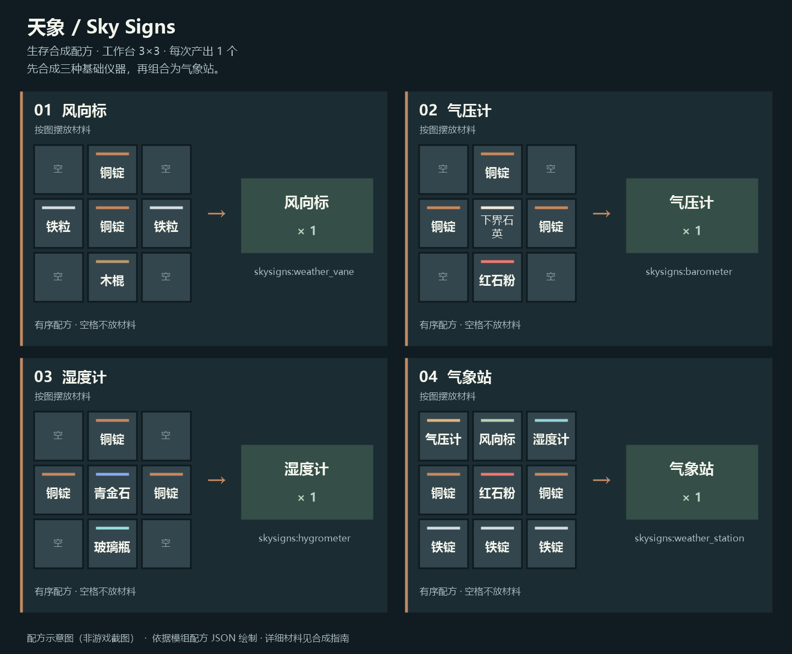

# 天象 / Sky Signs

为 Minecraft Java 版打造的原版风格天气观测模组。天象让晴天、降雨、雷暴和风况随时间变化，并通过风向标、气压计、湿度计与气象站，让玩家观察当前环境和下一阶段的天气。

> **当前公开发行：[0.7.0-alpha.3 — P3 客户端设置预览](https://github.com/Araon7756/Sky-Signs-Public/releases/tag/v0.7.0-alpha.3)**，于 2026-10-17 发布，面向 Minecraft Java **1.21.10 · Fabric · Java 21**。在 P1 分阶段天气基础上加入共用客户端风状态、游戏内配置即时更新与原版风格设置页，属于 Pre-release，不代表完整 0.7 功能或稳定版。环境风粒子和风声尚未加入。

## 下载与安装

**[下载 0.7.0-alpha.3 普通 JAR](https://github.com/Araon7756/Sky-Signs-Public/releases/download/v0.7.0-alpha.3/skysigns-0.7.0-alpha.3.jar)** · [发布说明](https://github.com/Araon7756/Sky-Signs-Public/releases/download/v0.7.0-alpha.3/RELEASE_NOTES.md) · [测试报告](https://github.com/Araon7756/Sky-Signs-Public/releases/download/v0.7.0-alpha.3/TEST_REPORT.md) · [SHA-256 校验清单](https://github.com/Araon7756/Sky-Signs-Public/releases/download/v0.7.0-alpha.3/SHA256SUMS)

| 项目 | 要求 |
| --- | --- |
| 游戏版本 | Minecraft Java 1.21.10 |
| 加载器 | Fabric Loader 0.18.1 或更新版本；本次验收使用 0.19.5 |
| 依赖 | Fabric API；本次验收使用 0.138.4+1.21.10 |
| Java | Java 21 或更新版本；本次构建与验收使用 Java 21 |

1. **升级前完整备份世界，并先在副本中试用。** 模组的数据保护不保证整个世界可安全降级。
2. 在对应 Fabric 游戏实例安装 Fabric API，将 `skysigns-0.7.0-alpha.3.jar` 放入 `mods`，只保留一个天象版本。
3. 不要把 `-sources.jar` 放入 `mods`；它是供开发者阅读的源码包。

下载后可用 [SHA256SUMS](https://github.com/Araon7756/Sky-Signs-Public/releases/download/v0.7.0-alpha.3/SHA256SUMS) 校验。普通 JAR 大小为 **745608 字节**，SHA-256：

```text
e5d83192de25b3bf66b701fef4eca70dc6558d018ca22d4c47066f752623519d
```

测试覆盖见 [TEST_REPORT.md](https://github.com/Araon7756/Sky-Signs-Public/releases/download/v0.7.0-alpha.3/TEST_REPORT.md)，精确源码提交、工具链和产物摘要见 [BUILD_PROVENANCE.md](https://github.com/Araon7756/Sky-Signs-Public/releases/download/v0.7.0-alpha.3/BUILD_PROVENANCE.md)。开发者可另取 [sources JAR](https://github.com/Araon7756/Sky-Signs-Public/releases/download/v0.7.0-alpha.3/skysigns-0.7.0-alpha.3-sources.jar)。


*历史 beta.7 界面示意，不代表当前版本的全部天气阶段界面。*

## 生存合成

**四种观测仪器均可在生存模式下通过工作台合成。** 先制作风向标、气压计和湿度计，再将三者与铜锭、红石粉、铁锭组合为气象站。四种配方每次均产出 1 个仪器。



*配方示意图，非游戏截图；空格不放材料。*

完整材料数量、逐格摆法及从零制作气象站的总材料见 **[生存合成指南](docs/CRAFTING.md)**。配方书中没有显示时，也可按图在工作台手动摆放。

## 主要功能

### 天气、风况与预报

- 服务端统一安排晴、雨、雷暴的前兆、切换与过渡／缓和，并提前确定下一阶段。气压、湿度天气基值和自动风目标区间接入同一计划；目前不增加独立天气类型或降雨强度系统。
- 天气与风况支持自动／手动模式，随维度保存。从手动恢复自动时先保留当前天气，再安排新周期；关闭原版天气循环时，自动预报显示暂停。
- 原版 `/weather`、睡觉或其他模组改变实际天气后，天象会采纳新状态并重新安排预报。
- 服务端约每秒同步一次风况，客户端平滑显示。当地雨雪依照原版群系、温度与天空遮挡判定，不在下界等不适用环境生成原版降雨。

### 观测仪器

| 仪器 | 可以观察什么 |
| --- | --- |
| 风向标 | 旋转箭体显示风向，右键查看天气、剩余时间和风力；基座保持固定。 |
| 气压计 | 当前气压及上升、稳定、下降趋势，指针随读数变化。 |
| 湿度计 | 综合群系、天气、温度、海拔和附近水体估算环境湿度。 |
| 气象站 | 每秒更新天气、气压、湿度、风况、下一阶段趋势和天气阶段时间线。 |

气压计、湿度计和气象站可按玩家放置方向朝向不同方位。气象站界面支持标准／紧凑布局，长文本可悬停查看；旧版仪表在区块加载时补建所需方块实体，无须挖掉重放。

风向标接触水体时停止观测；气象站不能在水中放置，被淹时停止报告并关闭界面，排水后恢复。主动桶注水需用空桶排水。

### 雨雪风效与光影

未启用光影包时，客户端可按风向轻微倾斜原版雨雪纹理，不额外生成粒子，也不改变服务端天气或降水判定。检测到 Iris 光影包时会自动停用这项顶点偏移；关闭光影后无需重启即可恢复。

## 本次验证与已知限制

`0.7.0-alpha.3` 已完成 Public 源码独立构建、测试源码编译、JAR 内容审计、隐私与 Gitleaks 扫描、SHA-256 校验，以及默认完整客户端回归：17 个就绪阶段、4 个连接 epoch、24 张自动截图。最终普通 JAR 在最小 Fabric API 隔离实例中两次独立启动，中文 GUI2、1280×720 验证了关闭保留强度、保存后重启持久化、恢复默认和未知键保留，两次正常保存退出，3 张 F2 原始截图已实际目视。

发行源码目标上的 `Java 21 build`、`Gitleaks`、`Commit identity guard` 均通过。回归在候选提交前运行，最终发行源码的生产／构建／测试／法律输入已核对一致，合并后未重新运行游戏；完整来源及前次合并身份检查失败的保留记录见发行测试报告。#49 仅显式用于测试框架，不进入普通 JAR，原生方格区块等待仍未修复。

本轮没有单独重跑 P1_ONLY 或真实 Iris／Photon 矩阵。完整 P1、GUI／语言／DPI／分辨率与旁白听感、全部权限／I/O 故障、多人／专用服务器、旧客户端互通、完整旧世界迁移、性能回退和长期可靠性仍未验证；`test NO-SOURCE`、CI 构建及短时单人结果不扩大为这些范围通过。

Photon 的降雪可见度差异、动态忽隐忽现反馈及历史窗口缩放／闪电黑屏问题仍保留，根因未定位。有限时窗未捕获不等于问题解决；模拟 Iris API 断言与历史真实光影的限定证据分别记录。详见 [已知限制](docs/KNOWN_ISSUES.md) 和发行附件 [测试报告](https://github.com/Araon7756/Sky-Signs-Public/releases/download/v0.7.0-alpha.3/TEST_REPORT.md)。

[Public alpha.2](https://github.com/Araon7756/Sky-Signs-Public/releases/tag/v0.7.0-alpha.2) 是 2026-10-15 的首个 Public 二进制发行，其新建世界 smoke test 与当时的未验证范围保留在该版本附件中。旧标签、附件及结果保持原样。

历史 Private alpha.1 的完整客户端回归、P1 专项和 WEATHER v1 自动世界副本的有限迁移记录仅作为历史摘要，不能算作本轮重新执行。历史验收和失败证据、旧 Git 历史及原始日志／录像继续留在 Private 档案，见 [公开快照说明](docs/PUBLIC_SNAPSHOT.md)。

## 游戏内命令

| 命令 | 用途 | 权限 |
| --- | --- | --- |
| `/skysigns status` | 查看当前天气与风况。 | 玩家 |
| `/skysigns forecast` | 查看当前位置的气压、湿度、当地降水与天气趋势。 | 玩家 |
| `/skysigns wind set <degrees> <strength>` | 手动设置风向与强度。 | 等级 2 |
| `/skysigns wind auto` | 恢复风况自动变化。 | 等级 2 |
| `/skysigns weather set clear\|rain\|storm` | 立即切换天气并进入手动模式。 | 等级 2 |
| `/skysigns weather auto` | 恢复天气自动循环。 | 等级 2 |

风向角度为 **0° 北、90° 东、180° 南、270° 西**；强度取 **0～100**。天气和风况状态会随世界保存，包括自动/手动模式及下一次变化时间。

存档格式、逐级迁移与未知／未来版本保护的边界见 [SAVE_DATA.md](docs/SAVE_DATA.md)。

## 客户端设置

alpha.3 提供原版风格“Sky Signs 设置”。设置按键默认未绑定，可在原版控制设置中绑定，或从气象站标题栏进入；降水倾斜开关和 0～100% 强度立即生效，关闭保留强度，完成／Esc 保存。保存失败可重试或明确不保存返回；恢复默认值保留未知配置键。Iris 光影开启或 API 查询失败时显示原因、停用倾斜控件并保留偏好。

这些设置仅影响当前玩家的画面，不改变服务端天气、真实风况、仪表读数或其他玩家。配置文件为 `config/skysigns-client.properties`；在游戏外手动编辑后需重启游戏：

```properties
wind_precipitation_enabled=true
wind_precipitation_strength=1.0
```

将 `wind_precipitation_enabled` 设为 `false` 可保留原版雨雪外观；`wind_precipitation_strength` 可在 **0.0～1.0** 之间调整倾斜强度。这两个选项只影响客户端画面，不影响服务端天气、碰撞或降水判定。启用 Iris 光影时，即使设置为 `true`，降水顶点倾斜仍会自动停用。

## 开发与构建

安装 JDK 21 后，在项目根目录运行：

```powershell
.\gradlew.bat build --no-daemon
.\gradlew.bat compileGametestJava --no-daemon
```

Linux/macOS 可用 `bash ./gradlew build --no-daemon` 和 `bash ./gradlew compileGametestJava --no-daemon`。测试源码编译不启动游戏；客户端回归方法及显式测试补丁入口见 [TESTING.md](docs/TESTING.md)。

构建产物位于 `build/libs/`。需要对应已发布版本的源码时，使用 `v0.7.0-alpha.3` 标签；精确构建来源及官方 JAR 摘要以 Release 附件为准。

Public 仓库的 [基础 CI](.github/workflows/public-ci.yml) 在针对 `main` 的 Pull Request 和 `main` 推送上检查 Java 21 构建、测试源码编译及 Gitleaks；独立的 [Commit identity guard](.github/workflows/identity-guard.yml) 检查本次新增提交的作者和提交者邮箱。CI 不启动 Minecraft；`test NO-SOURCE`、构建和源码编译成功均不代表客户端、多人、专用服务端、光影或长期稳定性通过。具体范围见 [测试说明](docs/TESTING.md#public-仓库基础-ci)。

## 文档与反馈

[架构](docs/ARCHITECTURE.md) · [存档格式](docs/SAVE_DATA.md) · [测试说明](docs/TESTING.md) · [已知问题](docs/KNOWN_ISSUES.md) · [路线图](docs/ROADMAP.md) · [开发历史](docs/DEVELOPMENT_HISTORY.md)

当前支持基线是 Minecraft Java 1.21.10 + Fabric。其他游戏版本与加载器仍属规划，具体范围见 [路线图](docs/ROADMAP.md#多版本与多加载器支持规划)。

欢迎通过 [Issues](https://github.com/Araon7756/Sky-Signs-Public/issues) 提交问题和建议，请附版本、复现步骤及脱敏后的必要日志。首次 Public 阶段暂不接收外部贡献 PR，具体反馈与贡献政策见 [CONTRIBUTING.md](CONTRIBUTING.md)。

## 许可证与媒体许可

本源码版本中有权许可的项目自有内容采用 [PolyForm Noncommercial 1.0.0](LICENSE) 官方原文，许可主体通知见 [COPYRIGHT](COPYRIGHT)。软件范围、第三方例外及历史 MIT 边界见 [LICENSE_SCOPE.md](docs/legal/LICENSE_SCOPE.md)。主要许可证标识不表示仓库所有文件都只有同一许可。

正常 Minecraft 游戏视频、直播、教程和评测，以及普通平台广告分成、创作者奖励和无对价自愿打赏，另见 [独立媒体额外许可](docs/legal/MEDIA_PERMISSION.md)。其中为媒体制作所合理必需的安装和执行是有限授权，不扩大一般商业软件使用、收费服务器、软件销售、收费整合包或商业修改的权限。Minecraft 及其他素材仍须符合权利人的独立规则。

非商业个人用途及正式文本列明的组织用途按 PolyForm 原文判断。收费服务器和一般企业业务部署可能需要单独商业授权；媒体许可不提供这些软件运营权限。收费分发、收费整合包等场景涉及 Distribution License 与用途条款的解释空间，请联系维护者确认具体模式。此联系建议不把所有收费分发宣称为已被明确禁止，也不增加正式文本未设的批准义务或缩减其已授权利。

**既有正式发布 v0.6.0-beta.9 及其他历史 MIT 版本保持原授权。** 不能用最新根 LICENSE 改写旧 Release。历史 Private `v0.7.0-alpha.1` 保持原包与来源，不重新发布、覆盖、删除；Public alpha.2 与 alpha.3 均从各自的公开源码独立构建，保留对应附件及来源记录。来源边界见 [公开快照说明](docs/PUBLIC_SNAPSHOT.md) 和本版发行附件。旧 MIT 代码仍可在符合旧许可通知条件下继续商业使用和衍生；未来新增表达不会自动继承旧 MIT。

第三方源码拷贝、Wrapper 和依赖见 [THIRD_PARTY_NOTICES.md](docs/legal/THIRD_PARTY_NOTICES.md)，来源记录见 [SOURCE_PROVENANCE.md](docs/legal/SOURCE_PROVENANCE.md)，未来外部贡献规则见 [CONTRIBUTING.md](CONTRIBUTING.md)。本项目采用非商业源码可用许可，不将新许可称为 OSI 意义上的开源许可。

项目采用 AI-assisted 开发。图标、AI 输出的权利边界和 Unable to verify 项以 [SOURCE_PROVENANCE.md](docs/legal/SOURCE_PROVENANCE.md) 为准，不将来源记录扩大为全部制作链已验证或全部内容具有可排他版权。
