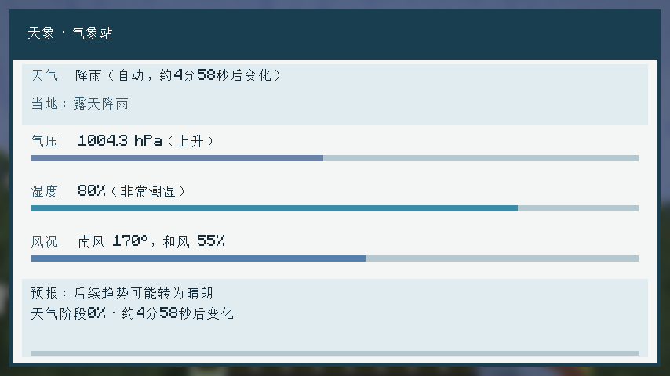

# 天象 / Sky Signs

为 Minecraft Java 版打造的原版风格天气观测模组。天象让晴天、降雨、雷暴和风况随时间变化，并提供风向标、气压计、湿度计与气象站，让玩家能观察当前环境和下一阶段的天气。

> **当前公开源码版本：0.7.0-alpha.1 / Minecraft Java 1.21.10 / Fabric / Java 21。** 本仓库提供经审核的独立公开源码快照。原 Private 开发仓库继续保存完整历史和原始证据。版本为 P1 阶段预览，不代表完整 0.7 功能或稳定版。

本仓库提供源码与构建方法，当前 Public 仓库暂未提供独立公开 Release 下载。原 Private 仓库中的 Release、分支、标签和 Issue 不随快照迁移。发行来源与验收边界见 [公开快照说明](docs/PUBLIC_SNAPSHOT.md)；安装前完整备份世界，并先在副本中试用。



*上图为历史 beta.7 界面展示，不能代表 alpha.1 的全部天气阶段界面。*

## 主要功能

### 天气与风

- 天气、风向、风力及自动／手动模式随维度保存；天气演变适用于有天光且无顶棚的维度，不在下界等不适用环境生成原版降雨。
- 服务端按游戏时间统一安排晴、雨、雷暴的前兆、切换与过渡／缓和，并提前确定下一阶段，使预报与实际计划保持一致。气压、湿度天气基值和自动风目标区间接入同一计划；连续观测不等于新增降雨强度或独立天气类型。
- 从手动模式恢复自动模式时，当前天气保持不变，再按新周期安排下一次变化；关闭原版天气循环时，自动预报显示暂停状态。
- 原版 `/weather`、睡觉或其他模组改变实际天气后，天象会采纳新的天气并重新安排预报，减少天空与仪器显示不一致的情况。
- 风向会逐步转向目标方位。服务端目前约每秒同步一次风况，客户端平滑过渡；自动天气切换提示会区分自动风况调整和手动风况保持不变。
- 当地降水依照原版在具体位置的群系、温度与天空遮挡判定：同一场全局降雨可能表现为露天降雨、露天降雪、被遮挡，或无降水。

### 观测仪器

| 仪器 | 可以观察什么 |
| --- | --- |
| 风向标 | 以 0～359° 方位随风旋转；右键查看天气、剩余时间、风向和风力。基座保持固定，旋转箭体具有对应的碰撞轮廓。 |
| 气压计 | 显示当前气压及上升、稳定、下降趋势；带刻度的指针随读数变化。 |
| 湿度计 | 综合天气、群系湿润度与降水属性、温度、海拔及附近水体估算环境湿度；带刻度的指针显示读数。 |
| 气象站 | 右键打开每秒更新的观测界面，汇总全局/当地天气、气压、湿度、风况、下一阶段趋势和天气阶段时间线。 |

气压计、湿度计与气象站可按玩家放置方向朝向不同方位，仪表指针和碰撞轮廓会随之转向。仪器模型包含底座、边框、刻度和指示灯；物品栏外观与方块模型相对应。表盘指针按左低右高显示读数（包括湿度 88% 等高读数），并通过缩短、前移指针与分层顶盖减少穿模和重合面闪烁。气象站界面使用高对比度文字和清晰分区，物品栏预览展示正面屏幕。旧版已放置仪表在区块加载时会补建所需的方块实体，无须挖掉重放。

湿度计算使用群系自身的气候数据，而非写死群系名称，因此能适应遵循原版气候字段的地形模组与数据包。无降水群系不会仅因全局下雨就变得和雨林一样潮湿。气压计按需计算，不会附带扫描附近水体；湿度计每秒采样一次，多台仪表错开采样时刻，以降低同一游戏刻的集中负担。

beta.7 为两个表盘增加统一的分层顶盖、铜边框与轴心细节，气象站增加可见脚座、阶梯底座与顶盖；物品栏静态仪表外壳与世界模型使用相同几何数据并有一致性断言。气象站界面保留原版字号，按可用高度切换标准／紧凑布局，并根据翻译后的标签宽度排列读数；长文本截断后可悬停查看全文。此轮不增加天气类型、网络请求频率或环境扫描。

从 beta.8 起，风向标接触水体时停止观测，气象站禁止在水中放置、被淹时停止报告并关闭界面，排水后恢复。流水不会转为底座新水源；主动桶注水需用空桶排水。beta.8 的人工验收与当时完整 GameTest 阻塞记录作为历史保留；本轮 alpha.1 的实际回归及限制见下文。

### 雨雪风效与光影

未启用光影包时，客户端可根据风向轻微倾斜原版雨雪纹理：只调整已有降水四边形的上沿，不额外生成粒子，也不改变服务端的天气或降水判定。检测到 Iris 光影包时，天象会自动停用这项顶点偏移，避免与光影自身的降水渲染冲突；关闭光影后无需重启即可恢复。

## 安装与兼容性

| 项目 | 要求或说明 |
| --- | --- |
| 游戏版本 | Minecraft Java 1.21.10 |
| 加载器 | Fabric Loader 0.18.1 或更新版本（开发环境使用 0.19.5） |
| 依赖 | Fabric API |
| Java | Java 21 或更新版本 |

1.21.10 + Fabric 是当前支持基线。后续计划逐步支持其他 Minecraft Java 版本，并评估 NeoForge、Forge 等其他加载器；具体目标组合、维护范围和发布日期待评估确认，见 [多版本与多加载器支持规划](docs/ROADMAP.md#多版本与多加载器支持规划)。当前安装仍按上表要求。

从源码构建得到 `build/libs/skysigns-0.7.0-alpha.1.jar`，将普通 JAR 放入游戏实例的 `mods` 文件夹，并确保只保留一个天象版本；不要安装 `-sources.jar`。构建方法见下文。

原 alpha.1 发行在隔离单人实例中已有构建、测试源码编译、显式启用 #49 的默认完整客户端回归、独立 P1 专项及真实 WEATHER v1 自动世界副本的有限验收记录。此处是历史结果摘要，本次公开快照验证只执行构建与源码编译，不重跑客户端，不将历史游戏通过转为当前快照实机通过。详见 [测试说明](docs/TESTING.md) 与 [公开快照说明](docs/PUBLIC_SNAPSHOT.md)。

完整 P1 八项矩阵仍有未覆盖子项。真实 v0 自动／手动和 v1 手动世界、旧客户端互通、多人／专用服务端、性能回退与长期可靠性未验证；短时单人通过不代表这些范围通过。Photon 的雪可见度差异与历史窗口缩放／闪电黑屏根因未定位，有限动态窗口未捕获不等于问题解决。其余记录见 [测试说明](docs/TESTING.md)、[P1 验收清单](docs/P1_RELEASE_CHECKLIST.md) 和 [已知限制](docs/KNOWN_ISSUES.md)。

历史发行与失败证据由原 Private 档案保存；公开版保留必要技术摘要与限制，旧包测试结果不能代替当前快照验证。

已在隔离客户端测试中加载 Terralith、Tectonic 和 Lithostitched，验证过部分群系的湿度与高海拔降水样本；这不代表所有地形组合都已覆盖。完整整合包、不同光影包及独立多人服务端仍需继续回归测试。遇到问题时，请附上模组版本、复现步骤和该次的新日志或崩溃报告。

## 游戏内命令

| 命令 | 用途 | 权限 |
| --- | --- | --- |
| `/skysigns status` | 查看当前天气与风况。 | 玩家 |
| `/skysigns forecast` | 查看当前位置的气压、湿度、当地降水与天气趋势。 | 玩家 |
| `/skysigns wind set <degrees> <strength>` | 手动设置风向与强度。 | 等级 2 |
| `/skysigns wind auto` | 恢复风况自动变化。 | 等级 2 |
| `/skysigns weather set clear\|rain\|storm` | 立即切换天气并进入手动模式。 | 等级 2 |
| `/skysigns weather auto` | 恢复天气自动循环。 | 等级 2 |

风向角度为 **0° 北、90° 东、180° 南、270° 西**；强度取 **0～100**。天气和风况状态会随世界保存，包括自动/手动模式及下一次变化时间。

从 beta.6 起，天气、风况和仪表使用独立的存档结构版本，旧版无版本数据按步骤迁移；alpha.1 的 WEATHER 升级为 2，WIND／METER 保持 1。未知未来格式采用只读保护，不将原始载荷降级重写；保护只限模组自有数据，不保证整个世界降级安全。真实旧世界本轮迁移证据限定于 v1 自动世界副本。升级前仍需自行完整备份世界，不建议直接降级。格式、保护边界和测试范围见 [存档格式与迁移](docs/SAVE_DATA.md)。

## 客户端设置

首次运行后会生成 `config/skysigns-client.properties`。修改后需重启游戏：

```properties
wind_precipitation_enabled=true
wind_precipitation_strength=1.0
```

将 `wind_precipitation_enabled` 设为 `false` 可保留原版雨雪外观；`wind_precipitation_strength` 可在 **0.0～1.0** 之间调整倾斜强度。这两个选项只影响客户端画面，不影响服务端天气、碰撞或降水判定。启用 Iris 光影时，即使设置为 `true`，降水顶点倾斜仍会自动停用。

## 开发与构建

安装 JDK 21 后，在项目根目录运行：

```powershell
.\gradlew.bat build --no-daemon
.\gradlew.bat compileGametestJava --no-daemon
```

Linux/macOS 可用 `bash ./gradlew build --no-daemon` 和 `bash ./gradlew compileGametestJava --no-daemon`。测试源码编译不启动游戏；客户端回归方法及显式测试补丁入口见 [TESTING.md](docs/TESTING.md)。

构建产物位于 `build/libs/`。当前仓库处于持续开发阶段；若从最新源码构建遇到问题，请先确认所用分支与提交，再提供完整的 Gradle 错误输出。许可证及历史版本范围见下文。

## 许可证与媒体许可

本源码版本中有权许可的项目自有内容采用 [PolyForm Noncommercial 1.0.0](LICENSE) 官方原文，许可主体通知见 [COPYRIGHT](COPYRIGHT)。软件范围、第三方例外及历史 MIT 边界见 [LICENSE_SCOPE.md](docs/legal/LICENSE_SCOPE.md)。主要许可证标识不表示仓库所有文件都只有同一许可。

正常 Minecraft 游戏视频、直播、教程和评测，以及普通平台广告分成、创作者奖励和无对价自愿打赏，另见 [独立媒体额外许可](docs/legal/MEDIA_PERMISSION.md)。其中为媒体制作所合理必需的安装和执行是有限授权，不扩大一般商业软件使用、收费服务器、软件销售、收费整合包或商业修改的权限。Minecraft 及其他素材仍须符合权利人的独立规则。

非商业个人用途及正式文本列明的组织用途按 PolyForm 原文判断。收费服务器和一般企业业务部署可能需要单独商业授权；媒体许可不提供这些软件运营权限。收费分发、收费整合包等场景涉及 Distribution License 与用途条款的解释空间，请联系维护者确认具体模式。此联系建议不把所有收费分发宣称为已被明确禁止，也不增加正式文本未设的批准义务或缩减其已授权利。

**既有正式发布 v0.6.0-beta.9 及其他历史 MIT 版本保持原授权。** 不能用最新根 LICENSE 改写旧 Release。本次已发布的 v0.7.0-alpha.1（原 Private 档案；不随此快照公开） 普通生产 JAR 随附 PolyForm Noncommercial 1.0.0 与上述法律文件；精确标签、构建来源及摘要见 [公开快照说明](docs/PUBLIC_SNAPSHOT.md)，不再以早期暂定的 beta.1 名称判断许可采用状态。旧 MIT 代码仍可在符合旧许可通知条件下继续商业使用和衍生；未来新增表达不会自动继承旧 MIT。

第三方源码拷贝、Wrapper 和依赖见 [THIRD_PARTY_NOTICES.md](docs/legal/THIRD_PARTY_NOTICES.md)，来源记录见 [SOURCE_PROVENANCE.md](docs/legal/SOURCE_PROVENANCE.md)，未来外部贡献规则见 [CONTRIBUTING.md](CONTRIBUTING.md)。本项目采用非商业源码可用许可，不将新许可称为 OSI 意义上的开源许可。
